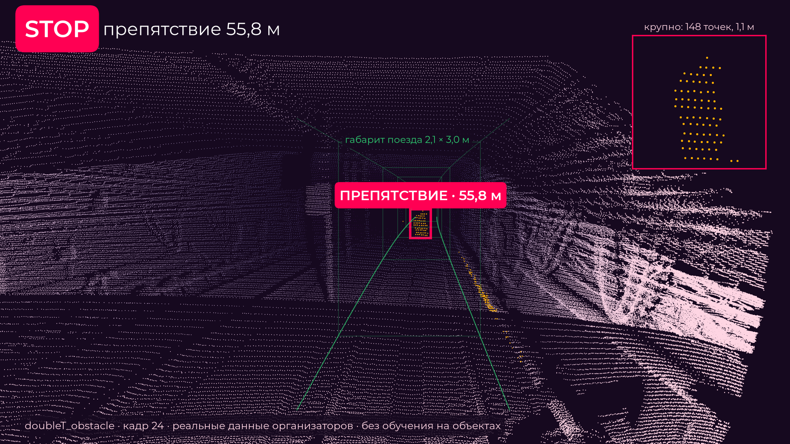
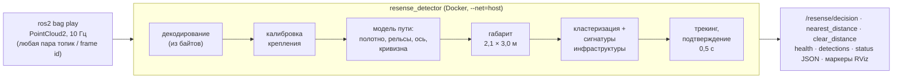
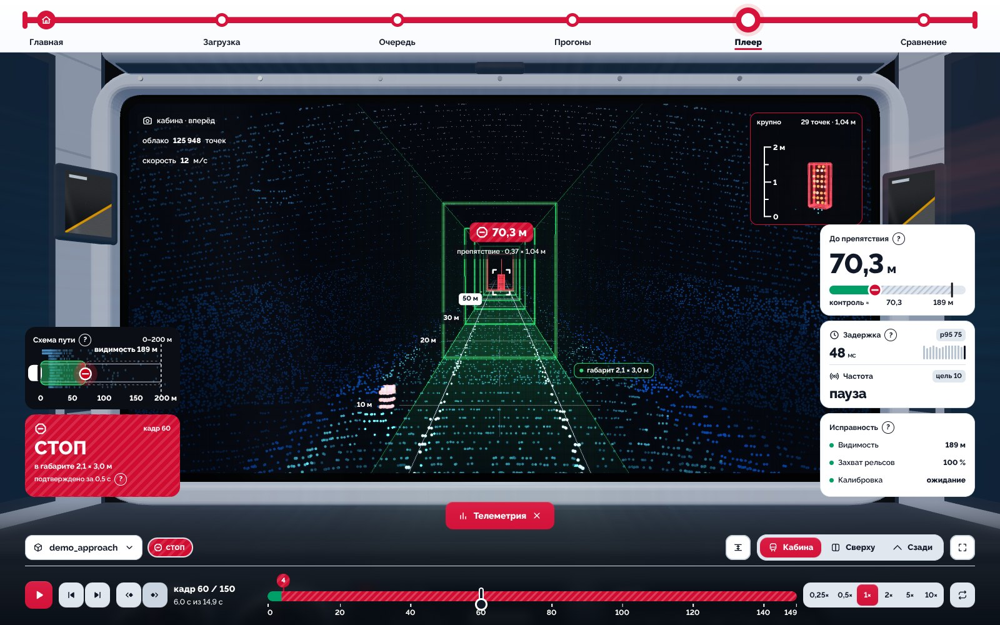

# ReSense — обнаружение препятствий по данным LiDAR в габарите метро

[](https://github.com/pmixay/ReSense/actions/workflows/ci.yml)
· ЛЦТ 2026, кейс 05 (Московский метрополитен) · команда «Молоток» · текущий опубликованный релиз — **v1.2.0** (20.10); 1.3.0 — кандидат в исходниках, не выпущен ·
**Руководство пользователя: [resense.gitbook.io/resense-docs](https://resense.gitbook.io/resense-docs/)** ·
**Веб-прототип онлайн: [resense.arbuz.lol](https://resense.arbuz.lol/)**

ReSense по поступающим облакам LiDAR сообщает беспилотному поезду метро, находится ли внутри его габарита
что-то, чего там быть не должно, и на каком расстоянии впереди по пути. Это нода ROS 2 Humble в
образе Docker, только CPU. По каждому облаку LiDAR она строит модель нормального тоннеля — полотно,
головки рельсов, ось пути и её кривизну по стенам, — вырезает вдоль неё габарит поезда 2,1 × 3,0 м,
заданный организаторами, и сообщает о каждом устойчивом объекте внутри него: без классов объектов,
без карты, без обучения на препятствиях. Ответ — `/resense/decision` (`GO` / `CAUTION` / `STOP` /
`FAULT`) и `/resense/nearest_distance` в метрах.

### Версии и их статус (проверено 23.10 по тегам git, CHANGELOG и ревью)

| версия | статус | что это значит |
|---|---|---|
| **v1.2.0** | **текущий опубликованный релиз** | тег `v1.2.0` = `3b73bbe`, релиз GitHub 2026-10-20 20:58 UTC, образ `resense-image-v1.2.0.tar.gz`. По сообщению команды (23.10), она выпущена и рассмотрена жюри; **баллов и отчёта жюри в репозитории нет** |
| 1.3.0 | **кандидат, не выпущен** | в исходниках этой ветки (все четыре объявления версии — 1.3.0, печать 42 файла, `verify` проходит). **Тега `v1.3.0` нет, релиза и образа нет**; независимое ревью (сессия ИИ, не жюри) — ACCEPT WITH CONDITIONS 22.10; на held-out G3 не запускалась, оценки J1 нет. Улучшения 1.3.0 измерены на наших же записях и сценах (в выборке) и имеют цену — см. раздел ниже |
| v1.0.0 | прежний релиз (29.09) | тег `5d6e9b5`; именно его оценивал наш независимый агент-судья 13.10 — **66/100 относится только к v1.0.0** и не является баллом организаторов; ни v1.2.0, ни 1.3.0 этот судья не оценивал |
| 1.1.0 | не выпускалась | опечатана 16.10, решение капитана 19.10: не выпускать; вошла в 1.2.0 |

Все числа «Результатов» ниже, помеченные 13.10 / «шлюз 29.09», — измерения v1.0.0. Проверка 23.10 на двух реальных бэгах
организаторов ([материалы](docs/evidence/version_check_2026-10-23/README.md)): v1.0.0, v1.2.0 и дерево 1.3.0 дают **одинаковые решения
кадр в кадр** — `doubleT_obstacle` 193 STOP из 201 (с 8-го кадра, 55,5–56,6 м), `roundT_doubleT` без STOP; выигрыш 1.3.0
на этих записях не проявляется (он на кривых, синтетике и записи Falcon, которых в этих двух бэгах нет).

### L16/S3: исправлен ложный FAULT при старте под открытым небом — 20 октября

Замечание P4 A1 воспроизведено на актуальном `main` и исправлено: земля под сканером
больше не принимается за направление движения −Z. В исходной 450-кадровой сцене
**450 FAULT →450 GO**; все **446 обнаружений контрольного препятствия** сохранены.
**242 целевых теста проходят**. На 120 исходных CDR-кадрах из 12 записей A1 не встретился;
в 120 парных случаях старта /3840 кадрах результаты и ориентация сохранены.
Проверены **27 580 парных кадров** полных записей и префиксов. После объединения с текущим
`main` (F1a) заново пройдены **gate без исключений, X3 — 40 случаев /29 765 кадров,
489 затронутых тестов**, проверены все 4443 кадра Falcon.
[Доказательства A1/T1](docs/evidence/l16_open_air_2026-10-20/README.md) сохраняют сбои
полного pytest и отдельную цену F1a по ложным тревогам на поездке.
Общая независимая приёмка и перепечатка остаются отдельной работой.

### R3: разобрано падение агрегата Set F — 20 октября

Свежая парная проверка R3 на **30 последовательностях / 3060 кадрах с каждой стороны**:
**0 потерянных попаданий, 9 новых попаданий по кабелю**, ложных обнаружений не добавилось.
Медиана held90 **34,2 →17,8 м** считается только по успешным последовательностям: их стало
**4/6 вместо 2/6**. Прежние результаты **19,0 и 49,5 м** сохранились, добавились **16,6 и 16,4 м**.
Исправлена отчётность: добавлены размер выборки и парное сравнение; детектор и исходная метрика сохранены.
[Покадровая проверка и исправление отчётности](docs/evidence/r3_sustained_2026-10-20/README.md).
Замечания P4 к R3 и финальная независимая приёмка остаются открытыми.

Предпросмотр веб-интерфейса: **[resense.arbuz.lol](https://resense.arbuz.lol/)** (ветка `ui-improvement` влита в `main` PR #47 20.10 и удалена);
его `/deployment.json` отдельно идентифицирует веб-сборку, не релиз ROS-образа.

### H1: зафиксированный частичный результат на 20 октября

В исходниках 1.2.0 принято **частичное улучшение H1**, а не закрытие задачи. Новый путь
положительного свидетельства столкновения (`cluster.column_core_margin=0.02`) сохраняет
высокое узкое тело как препятствие при поддержке текущими точками, свежими рельсами и
проверками геометрии. После обычного подтверждения он снимает только удержание `column`.
Снятый эксперимент `column_free_max_top` остаётся выключенным.

* **A-axis** (искусственный столб в реальных сканах): **82 → 114 из 177** видимых кадров;
  **63 пропуска остаются**. Это не обнаружение реального столба на измеренной дальней оси.
* **Физическая синтетика:** все 32 стоящих случая дают STOP в каждом кадре после подтверждения;
  три трудных случая на 137 м улучшены с 1/14 до 10/14 кадров. В 280 внешних контролях нет ложных
  STOP. При 22 м/с непрерывный STOP в двух номинальных сценах начинается с 130,8 и 135,2 м —
  **это модельные результаты, не подтверждённая реальная дальность или тормозная гарантия**.
* На исходниках, объединённых с `main` `0acb18c`: полный regression gate PASS (208 нетайминговых
  метрик совпадают с проверкой main); свежий X3 PASS — 40 случаев / 29 765 кадров. Полный pytest:
  2276 passed +17 subtests, один прежний сбой proxy-hook, восемь исключений по внешним данным.

**H1 остаётся OPEN:** независимый эталон дальней оси/траектории не получен; неправильный выбор
пары рельсов и сцены без свежих рельсов не имеют общего доказательства. Пользователь отдельно
разрешил публикацию этого частичного результата в `main`; это не новая печать или релиз.
[Зафиксированный результат и проверки](docs/evidence/h1_partial_integration_2026-10-20/README.md),
[попытки восстановления траектории](docs/evidence/h1_trajectory_2026-10-19/README.md).

### Состояние на 22 октября: 1.3.0 — кандидат, ревью принято с условиями, не выпущен

* **1.3.0** опечатан (42 файла, `853a05b7…`, измеренный коммит `ed67d25`, [печать](docs/DETECTOR_FREEZE.md)) и принят
  независимым ревью с условиями ([`DECISIONS.md`](docs/DECISIONS.md) строка 58). CI на объединённой ветке (`f24d939`) — все
  девять задач зелёные. Тега `v1.3.0` нет; тег и релиз — только после одобрения пользователя; до тех пор опубликованный релиз — v1.2.0, а образ из этой ветки содержит кандидата, а не релиз. Ревью выполнено сессией ИИ, не жюри; G3 не запускался.
* **Что даёт 1.3.0 — в выборке, не подтверждено на новых данных** (против свежего v1.2.0 на тех же данных; [`CHANGELOG.md`](CHANGELOG.md) [1.3.0],
  [ревью](docs/evidence/review_1.3.0_2026-10-22/README.md)):
  - Falcon Prime, путь `falcon_ros`: первый STOP человека 127,3 → **150,5 м**; удерживаемый STOP по шести стартам
    114,4–123,0 → **129,4–135,6 м**; ложные эпизоды STOP 3 → 0.
  - Кривые (K2 union), тот же объект в том же месте: первый STOP человека 46,5 → **71,2 м** (`roundT_doubleT`) и
    76,9 / 84,3 → **94,6 / 105,0 м** (`roundT_pressureGate_roundT`).
  - Чистая дистанция Falcon больше не заходит за останавливающий объект (575 → 0 строк).
  - Цена: +3 ложных эпизода STOP на поездке (все от K2), пустые записи +0; ни одного потерянного или задержанного
    истинного STOP. Время кадра Falcon выросло на 40–54 % по медиане (10 Гц на этот выпуск не требуется).
* **Чистая дистанция:** при политике `auto` и известной модели датчика опубликованная чистая дистанция ограничена (Pandar128 — не более 88,7 м; `falcon_ros` — не более 48,2 м на каждом кадре), поэтому прирост дальности STOP на Falcon (130–150 м) в `clear_distance` **не виден**; при неизвестной модели отдаётся прежняя (legacy) дальность.
* **Узел:** политика дальности по умолчанию `auto` — `conservative`, когда модель плотности датчика известна (названный
  `sensor_profile`, явный `range_sensor_model` или определение по полям точек облака: Falcon Prime — `scan_id` / `scan_idx` /
  `elongation` без `ring`, Pandar128 — `ring` с 64–128 каналами), иначе `legacy`. Решения STOP / GO от политики не зависят.
* **Ограничения:** +8 эпизодов STOP суммарно (+13, если считать оба пути Falcon), 10 из них — разрезы настоящего STOP на человеке; защита стрелочного перевода дальнего диапазона Falcon пропускает проходимые проёмы (задокументировано);
  H1 (высокие узкие объекты) открыт; малые объекты организаторов (куб 0,3 м с ~45 м) — заявленный предел.

### Состояние на 19 октября (вечер; запись интеграции до дополнения H1 выше)

* **Версия (22.10).** Опубликованы **v1.0.0** (его оценивали эксперты 30.09–14.10, а наш независимый судья — 13.10) и **v1.2.0** (текущий; по сообщению команды 23.10, рассмотрен жюри, баллов в репозитории нет) (тег `v1.2.0` = `3b73bbe`, GitHub, 2026-10-20 20:58 UTC; собран и проверен release workflow, запуск 39496692666). **1.1.0 не выпущен и выпускаться не будет**
  (решение капитана 19.10); его содержимое входит в 1.2.0. *(Запись ниже — состояние 19.10 вечером: тогда 1.2.0 был кандидатом.)* Кандидат 1.2.0 собран
  в ветке интеграции: `main` с L16/S3 и R3 от P3 плюс четыре ветки агентов (K1/K2, F1, Falcon, N3), влитые 19.10 с
  доказательством идентичности — полный шлюз по кадрам и вся запись Falcon при выключенных новых переключателях
  ([интеграция](docs/evidence/integration_2026-10-19/README.md)). P4 принял слитый источник B4 `0779db7` 19.10
  ([ревью](docs/evidence/p4_review_b4_merged_2026-10-19/README.md)).
* **Печать детектора проходит:** `python3 scripts/detector_freeze.py verify` — PASS (20.10: 40 файлов, перепечатка R3 на
  измеренном `0a472d6`, объединённом с main). Это целостность исходников, а не одобрение P4: итоговое независимое ревью
  остаётся открытым; J1 и G3 пойдут на итоговой печати 1.2.0, закрепление 1.1.0 снято
  ([`DETECTOR_FREEZE.md`](docs/DETECTOR_FREEZE.md)).
* **CI на `main`:** зелёный на `f56ad5e` (20.10, запуск 669). Позже набор браузерных тестов job `webapp` на `main` был красным (запуски #702, #704, #709, #711; checks, docker, pytest и offline-build прошли). У коммита v1.2.0 своего запуска CI нет: в сообщении squash есть «[skip ci]». Исправления e2e (терпеливые таймауты, reduced motion, четыре параллельных шарда) лежат в ожидающем pull request в `main`; запуск ветки #718 на `6ee469c` прошёл все job. Релиз v1.2.0 собран и проверен release workflow.
* **Переключатели 1.2.0** (решения капитана 19.10, [`DECISIONS.md`](docs/DECISIONS.md) строка 41): включены F1a, H′, R3 и
  L16/S3 (P3 завершил обе работы, ревью P4 — pending). **K2/K1 stay off in 1.2.0**:
  приёмочные критерии не выполнены ([строки и результаты](docs/evidence/k1_k2_repair_2026-10-20/README.md)).
  Оценка дальности Falcon действует только при политике `conservative` / `small_candidate`, не при `legacy`.
  Выключены также S2, дальность Falcon (`farrange`) и защита от пыли N3. Итоговые числа шлюза, X3 и записи Falcon — pending.
  **Остановка кода — 20.10 23:59 МСК**, работа по приоритетам P0/P1/P2 вместо дат (строка 42), защита 23.10:
  [`BACKLOG`](docs/BACKLOG.md) «Current plan».
* **Нового в 1.2.0** (по просьбам экспертов 16.10): габарит как устойчивый 3D-бокс в RViz и веб-просмотре; второй LiDAR
  Falcon Prime (профили `falcon_ros` / `falcon_native`, проверка ориентации: пока она не подтверждена — `CAUTION`, а не
  «тихий» `GO`); интерактивный запуск (пауза, скорость, несколько бэгов в одной ноде); разметка новых синтетических бэгов
  организаторов. Подробно — [`CHANGELOG.md`](CHANGELOG.md).
* **Falcon, реальная запись организаторов** (проверка 19.10, 4 443 кадра, на `aec88d2`, до переключателей 19.10):
  ориентация принята на 1-м кадре, тангаж −2,39° (независимая подгонка плоскости полотна: −2,37°); идущий к поезду человек:
  `STOP` с ~125 м и на всех кадрах до 20 м; 12 кадров ложного `STOP` за 444 с; с решениями 19.10 (F1a, H′, R3) — **4**: H′ убирает 8 кадров
  потолка тоннеля ниже 10 м, остаются 4 у конструкции на ~115 м; все 1 360 кадров `STOP` на человеке сохранены
  ([интеграция](docs/evidence/integration_2026-10-19/README.md)); `CAUTION` на 69 % кадров из-за двух неподвижных конструкций у края габарита. В
  облаке человек виден с ~249 м, но полотно и рельсы дальше ~150 м отражений не дают; 300 м не заявляются
  ([проверка](docs/evidence/falcon_head_check_2026-10-19/README.md), [дальность](docs/evidence/falcon_long_range_2026-10-19/REPORT.md)).
* **Ответы организаторов 19.10** (частично, [`answers.md`](docs/organizers/answers.md) §12): всё, что попадает в габарит
  поезда, — препятствие (значит `CAUTION` на объекте в габарите — пропуск); объекты могут двигаться; разметки нет, но есть
  порядок появления объектов (`obstacles.md`) и бэги с маркерами; пыль есть в каждом новом синтетическом бэге. Проверка
  ([материалы](docs/evidence/synth_markers_2026-10-19/README.md)): маркеры совпадают с `obstacles.md` (24 из 24) и с нашей
  разметкой (1 672 из 1 684 строк; один кубик в тоннелях мы пропустили); пыль — 1–14 точек на 1–2 кадра, 1.1.0 на неё не
  реагирует. Без ответа: формат защиты и засчитывается ли обновлённая версия, «работа фильтра», проигрывание бэгов.

История 15–29.09 и прежняя редакция этого раздела — [`docs/archive/README_history_2026-10-19.md`](docs/archive/README_history_2026-10-19.md);
18.10 (ориентация B4, профили Falcon, габарит N1, запуск N4, пыль, N6) — [`CHANGELOG.md`](CHANGELOG.md) [1.2.0],
[команды Falcon и интерактивной демонстрации](docs/evidence/n1_n4_2026-10-18/HOWTO.md).

## Кратко для жюри

**На стенде нет интернета**, поэтому образ поставляется архивом `resense-image-<версия>.tar.gz` (и
его `.sha256`) и загружается без сети; нода и всё, что ей нужно при работе, сети не используют.

```bash
sudo sysctl -w net.core.rmem_max=33554432                # 0. на хосте, до перезагрузки: буфер UDP для 360° облаков
docker load -i resense-image-<версия>.tar.gz             # 1. один раз, без интернета
docker run --rm -it --net=host --ipc=host resense        # 2. консоль 1: нода (команда образа — для записанных бэгов)
ros2 bag play <бэг> --delay 3 --read-ahead-queue-size 10 # 3. консоль 2: любой пользователь, ROS 2 Humble
ros2 topic echo /resense/decision --field data           # 4. консоль 3: GO | CAUTION | STOP | FAULT
ros2 topic echo /resense/nearest_distance --field data   # 5. расстояние до препятствия, м; −1 — нет
```

* **Одной командой:** `scripts/play_bag.sh <бэг> [--archive resense-image-<версия>.tar.gz]` —
  проверит и загрузит архив, поднимет буфер, запустит ноду, проиграет бэг и напечатает каждую смену
  решения с расстоянием («12.3 s  STOP  55.6 m»).
* **Где взять архив:** [релиз GitHub `v1.2.0`](https://github.com/pmixay/ReSense/releases/tag/v1.2.0),
  тег `v1.2.0` = **`3b73bbe`**, опубликован 20.10: `resense-image-v1.2.0.tar.gz` (472 124 881 байт,
  sha256 `89bd6b54c139e57c86ed222845f80816d7364b9e39f3cb80878576c7d5eba67c`), его `.sha256` и `SHA256SUMS`.
  `scripts/verify_release.sh v1.2.0` скачает и проверит архив (22.10: выход 0). Прежний релиз —
  [`v1.0.0`](https://github.com/pmixay/ReSense/releases/tag/v1.0.0), тег `5d6e9b5`, 29.09,
  `resense-image-v1.0.0.tar.gz` (477 449 541 байт); судья проверил его sha256 и офлайн-запуск 13.10.
  1.1.0 выпускаться не будет. Запасные пути — артефакт CI
  `resense-image-<версия>-<коммит>` (30 дней, нужен вход) или `scripts/export_image.sh`.
  С интернетом шаг 1 заменяет `docker build -t resense -f docker/Dockerfile .`.
  В проверенном судьёй задании CI сборка заняла 1:43; это не обещание времени холодной сборки.
* **Обязательно:** `--net=host` (DDS только по UDP) и `--read-ahead-queue-size 10` в шаге 3: без
  него `ros2 bag play` Humble отправляет начало записи пачкой, и результаты помечаются устаревшими.
  Шаг 0 нужен плееру на CycloneDDS; штатный Fast DDS доставляет облака и без него.
* **RViz** (нужен X11): вместо шага 2 — `xhost +local:docker && docker run --rm -it --net=host
  --ipc=host -e DISPLAY -v /tmp/.X11-unix:/tmp/.X11-unix resense ros2 launch resense_ros
  detector.launch.py rviz:=true freshness_mode:=replay`.
* **Веб-прототип** (без ROS и Docker; вне образа и релиза): открыть онлайн — **[resense.arbuz.lol](https://resense.arbuz.lol/)**, ничего не
  устанавливая; свой экземпляр — `scripts/run_webapp.sh` → http://localhost:8080 (первый запуск — `scripts/run_webapp.sh --install`, нужен интернет) — загрузка
  записи (файл, папка на сервере или демо-запись), очередь обработки, результаты прогона, сравнение,
  оценка по разметке, 3D-плеер из кабины и прямой эфир ноды; подробнее — [«Веб-прототип»](#веб-прототип).

**Falcon и интерактивный запуск (1.2.0).** Эти команды требуют образа 1.2.0 (релиз `v1.2.0` или сборка из `main`);
архив v1.0.0 новых профилей не содержит.

```bash
docker build -t resense:lidar-work -f docker/Dockerfile .
IMAGE=resense:lidar-work scripts/play_bag.sh --interactive --rate 0.5 \
  --clear-range-policy conservative \
  --sensor-profile pandar128 /data/PANDAR_BAG \
  --sensor-profile falcon_ros /data/falcon_test_second_dark
```

Space — пауза/продолжение, Right — одно сообщение на паузе, Up/Down — скорость. Между бэгами
остаётся тот же процесс ноды, но явно сбрасываются очереди, калибровка, треки и состояние
свежести. Имя контейнера для второй консоли печатает скрипт. Без `--interactive` работает
пакетный режим. Для RViz замените `play_bag.sh` на `run_demo.sh`; программный OpenGL включается
через `LIBGL_ALWAYS_SOFTWARE=1` (нужен X11, для проверки без экрана — `xvfb-run -a`).

В поставленной записи `/iv_points`, `seyond`, оси **+X вперёд / +Y влево / +Z вверх**:
профиль `falcon_ros`. Для нативных осей корпуса используется отдельный `falcon_native`
(**+Z / −Y / +X**). Профиль выбирается явно, из имени топика он не выводится. У Falcon нет
проверенной модели дальности малых объектов Pandar: в консервативном C2 `monitored_small=null`,
`clear_distance=0`; обнаружения и STOP продолжают работать. Зелёный бокс показывает поддержанную
геометрию габарита, отдельно от свободной дальности; при устаревшем входе он сереет и исчезает.
RViz удаляет необновлённый контур через 0,5 с от получения даже при блокировке ноды;
при обновлении реже 2 Гц возможны промежутки без контура.
[Команды и контракт отображения](docs/evidence/n1_n4_2026-10-18/HOWTO.md),
[измерения Falcon](docs/sensor/falcon_prime/README.md).

| `/resense/decision` | значение |
|---|---|
| `STOP` | **тревога**: подтверждённое препятствие в габарите 2,1 × 3,0 м; расстояние — `/resense/nearest_distance` |
| `CAUTION` | подсказка, не тревога: объект у габарита снаружи или за доверенной дальностью, известная инфраструктура, сниженная исправность |
| `GO` | препятствие не обнаружено (оценка дальности контроля — `/resense/clear_distance`; это оценка, а не гарантия) |
| `FAULT` | входа нет (до первого кадра, > 0,5 с без кадров) или ему нельзя доверять |

На `doubleT_obstacle` нода выдаёт `STOP` с 8-го кадра (человек входит в габарит) до конца записи на
55,5–56,6 м, без пропусков: 193 из 201 результата (текущий детектор; офлайн на сырой записи и через
ноду в Docker в CI). На `roundT_doubleT` (без препятствий) `STOP` нет.

## Результаты

**Последняя независимая оценка нашего судьи — 13.10, только v1.0.0: 66/100** (v1.2.0 и 1.3.0 не оценивались) по внутренней схеме весов,
не оценка организаторов и не баллы жюри ([`SCORECARD`](docs/SCORECARD.md),
[отчёт](docs/evidence/judgement_2026-10-13/README.md)). Node-path на исходных байтах:
193/201 STOP на реальном препятствии; пять пустых бэгов — 4 эпизода / 13 кадров STOP;
поездка — 32 эпизода / 160 кадров STOP (≈2,5 эпизода/км при 13 км).
На 4 vCPU нода 360° дала p95 111 мс и 35/201 актуальных результатов с флагами README;
буквальный плеер — ни одного актуального результата. Все частоты — в выборке.

Ниже — сохранённые измерения команды и **историческая** оценка 28.09; у каждой цифры указан пайплайн. Шлюз на кэше
1 см и node-path 13.10 не взаимозаменяемы, способы подсчёта двух источников разные
([`docs/EXPERIMENTS.md`](docs/EXPERIMENTS.md) «Два способа подсчёта»): **шлюз 29.09** — опубликованный детектор v1.0.0
(два правила из решений других команд включены, третье — `shell` — выключено после ревью безопасности; печать `7464d80`;
[`shell_off/`](docs/evidence/cycle_2026-09-29/shell_off/README.md)); **независимая оценка 28.09** — прежний детектор
`464f5bc`, то есть до правил 29.09 (каждый кадр сырых записей, свой подсчёт эпизодов; исторический отчёт
[в архиве SCORECARD](docs/archive/SCORECARD_history_2026-10-19.md), сырые данные — [`docs/evidence/judgement_2026-09-28/`](docs/evidence/judgement_2026-09-28/README.md);
прогоны на 4-ядерной ВМ — [`docs/evidence/vm_2026-09-28/`](docs/evidence/vm_2026-09-28/summary.md)). *В выборке*: правила
детектора настраивались на этих записях; нетронутых реальных препятствий нет. Новой оценки J1 для v1.2.0 и 1.3.0 нет ([`BACKLOG`](docs/BACKLOG.md) «Current plan»).

| что | результат | детектор, источник | данные |
|---|---|---|---|
| реальное препятствие, `doubleT_obstacle` (человек пересекает путь на 55–57 м, предмет на рельсе) | STOP с первого кадра, где человек в габарите (8-го), до конца записи без пропусков: 193 из 201 кадра, 55,5–56,6 м (метки 55,4–56,6 м) | v1.0.0: шлюз 29.09 и сырая запись ([материалы](docs/evidence/frame111_2026-09-29/README.md)) | реальные, в выборке |
| ложные тревоги, пять записей без препятствий (2 287 кадров, 250 с) | **12 эпизодов STOP**, 8 событий, 39 кадров тревоги; в 3 из 5 записей STOP нет | v1.0.0: шлюз 29.09 (до правил 29.09: 13 / 11 / 40) | реальные, в выборке |
| ложные тревоги, 20-минутная поездка (11 271 кадр, 13,0 км, без препятствий) | **30 эпизодов STOP = 2,3 на км**, 27 событий (2,1 на км), 126 кадров тревоги | v1.0.0: шлюз 29.09 (до правил 29.09: 31 / 32 / 130) | реальные, в выборке |
| 10 объектов организаторов, построенных лучевым методом (ray casting; 1 510 кадров) | STOP для **8 из 8** объектов внутри габарита, 411 кадров STOP внутри, куб снаружи — ни разу | v1.0.0: шлюз 29.09 (без изменений) | синтетические (организаторов), в выборке |
| досягаемость датчика | ни одного отражения дальше ~210 м ни в одном из 13 759 кадров: 300 м этому LiDAR недостижимы | не зависит от детектора | реальные |
| второй LiDAR Falcon Prime, реальная запись (4 443 кадра, 1.2.0) | отражения до 510 м; человек виден в облаке с ~249 м; `STOP` с ~125 м и на всех кадрах от 100 до 20 м; 12 кадров ложного `STOP`; `CAUTION` 69 % кадров. Ближний пропуск 2,5–7 м описан ниже | `aec88d2`, проверка 19.10 ([материалы](docs/evidence/falcon_head_check_2026-10-19/README.md)) | реальные (организаторов), разметка человека — своя |
| скорость, через ROS в Docker (плеер → результат) | 10 кадр/с, меньше одного ядра CPU. Актуальные результаты на 360° (облака по 24 МБ): e2e p95 81–82 мс, декодирование + обнаружение p95 63–72 мс (4-ядерная ВМ); 120°: 49–78 мс. Правила 29.09 добавляют к обнаружению +2,4 мс p95 на 360° кадре и +1,6 мс на 120° ([A/B](docs/evidence/cycle_2026-09-29/competitor_rules/latency_ab.json)). Старт (нода от 29.09 с явным `catchup_startup_step:=0.2`; умолчание теперь 0, при нём старт не измерен; [материалы-доказательства (evidence)](docs/evidence/node_startup_2026-09-29/README.md)): результаты первых 3 с имеют возраст 38–105 мс (медиана) вместо ~0,3 с; первый STOP через 0,8–1,0 с после первого облака | ВМ 28.09 и песочница на 4 vCPU (детектор до правил 29.09); A/B правил — 29.09 | реальные |
| тесты | последние целевые наборы тестов проходят (в том числе после слияния 19.10, [интеграция](docs/evidence/integration_2026-10-19/README.md)); состояние 19.10; **на 22.10** полный набор на дереве 1.3.0: 2 551 тест проходит, 0 падают (один тест `test_rail_start` падает одинаково и на v1.2.0, нужна запись поездки; 8 требуют записанных данных), CI на объединённой ветке `f24d939` — все девять задач зелёные ([CHANGELOG](CHANGELOG.md) [1.3.0]). Прежние «CI красный: 0 из 100» (19.10) и «1 284 теста» (29.09, v1.0.0) устарели | ветка интеграции, 19.10 и 22.10 | |

Строки независимой оценки 28.09 (прежний детектор, до правил 29.09) перенесены в [архив](docs/archive/README_history_2026-10-19.md): ложные тревоги 23 кадра STOP на пяти пустых записях и 30 эпизодов на поездке, первые STOP по синтетическим объектам, перенесённый человек.

**Известные ограничения** (подробности: [ARCHITECTURE «Известные ограничения»](docs/ARCHITECTURE.md#известные-ограничения)).
**Falcon, проверка 20.10:** в 38 кадрах без `STOP` детектор сообщает `clear_distance` 3,0–40 м
дальше человекоподобного объекта в 2,5–7 м впереди. Для передачи 1.2.0 это документировано как
[известное ограничение](docs/evidence/falcon_clear_limit_2026-10-20/README.md); исправление не принято.
Оценка «чистой дистанции» не подтверждает отсутствие препятствия; прежний результат дальнего
обнаружения человека не покрывает этот ближний пропуск.

Числа — v1.0.0, node-path 13.10; для v1.2.0 и 1.3.0 независимой перемеры (J1) нет, итоговые числа версий — в [`CHANGELOG.md`](CHANGELOG.md) и ревью 1.3.0. Куб 0,3 м набора O подтверждается с 48,0 м (на рельсе) /
55,8 м (по центру), краевой куб — с 35 м, висящий объект 5 см — с 30,1 м. За пределами доверенной дальности оси пути
(короткой на платформах и двухпутных участках) объект на пути получает `CAUTION`, а не `STOP`. Подтверждённый `STOP`
низкого объекта продолжается не дольше 0,3 с (`tracking.stop_keep_low_s`, подобрано на `doubleT_obstacle`). Два правила 29.09
из чужих решений (ревью безопасности: не блокирующие) задерживают `STOP` уходящего вперёд трека дальше 25 м и трека с
недавним попаданием в инфраструктуру (до ~1 с). `CAUTION` на пустом пути — 43 % (оценка 13.10). Пропуски высоких узких
объектов (`column`, H1 — **OPEN** по 8.1) и слияния на кривых ([`BACKLOG`](docs/BACKLOG.md) H1/H2, K1/K2). Все цифры в
выборке, разметка сделана инструментами команды. Печать: v1.0.0 — `7464d80`; v1.2.0 — перепечатка R3 (40 файлов); кандидат 1.3.0 —
`docs/evidence/detector_freeze_2026-10-22_1.3.0.json` (42 файла, `verify` проходит;
[`docs/DETECTOR_FREEZE.md`](docs/DETECTOR_FREEZE.md)).


*Реальные данные: `doubleT_obstacle` из кабины, человек на 55,8 м. Видео: обзор на 3:00
[`docs/video/resense_overview.mp4`](docs/video/resense_overview.mp4) (русские субтитры) и цепочка
Docker + RViz [`docs/video/docker_chain_rviz.mp4`](docs/video/docker_chain_rviz.mp4).*

## Как это работает



Для каждого кадра: облако читается из сериализованных байтов; крепление калибруется по рельсам; подбираются полотно,
головки рельсов и ось пути (кривизна — по стенам, поэтому коридор следует изгибам); габарит протягивается вдоль оси;
точки внутри него кластеризуются DBSCAN с адаптивным к дальности радиусом; кластеры, соответствующие инфраструктуре
тоннеля (колонны, грани стен, воздушные линии, знаки), — предупреждение; кластер, сохраняющийся 0,5 с внутри габарита, —
`STOP`. Правила 29.09: трек с недавней историей инфраструктуры без 5 чистых попаданий подряд и трек, расстояние до
которого не сокращается вместе с пробегом, `STOP` не начинают (остаются `CAUTION`). Небольшая обученная модель может
задержать сомнительный дальний `STOP` не более чем на 10 кадров, но не отменяет его.
Архитектура: [`docs/ARCHITECTURE.md`](docs/ARCHITECTURE.md); алгоритм и его математика:
[`docs/ALGORITHM.md`](docs/ALGORITHM.md); почему сделан каждый выбор: [`docs/DECISIONS.md`](docs/DECISIONS.md).

## Сборка, запуск, обработка бэга

```bash
docker build -t resense -f docker/Dockerfile .           # or ./scripts/build.sh; WITH_TOOLS=1 adds pytest, open3d, rosbags
docker run --rm -it --net=host --ipc=host resense        # the node; then play a bag from any console (above)
scripts/play_bag.sh /data/for_hackathon/doubleT_obstacle # node + player + decisions, one command
scripts/dry_run.sh  /data/for_hackathon/doubleT_obstacle # acceptance test: decisions, distance, latency, drops, pace
scripts/export_image.sh                                  # offline delivery: dist/resense-image-<ver>.tar.gz + .sha256
scripts/load_image.sh dist/resense-image-<ver>.tar.gz    # sha256, docker load, a --network none check
```

Без ROS и Docker (Python ≥ 3.10):

```bash
pip install -e ".[dev]" && pytest -q                     # the library, the tools, the C++ kernels if a compiler is present
resense run --bag /data/for_hackathon/doubleT_obstacle --out results.jsonl --render out/   # per-frame JSON + PNG
resense bench --bag /data/for_hackathon/roundT_doubleT --every 5                           # per-stage timing
```

Для **нового E2-совместимого** архива после `docker load` доступна пересборка исходников без сети (родительский образ
должен содержать зависимости и инструменты сборки; архивы до E2 этим свойством не проверены; локальная пересборка E2 —
**PASS**, около 19 с, [E2](docs/evidence/offline_rebuild_2026-10-15/README.md); в release workflow проверка включена, на
новом теге не запускалась):

```bash
docker build --network none --pull=false --build-arg RELEASE_IMAGE=resense:<версия> -f docker/Dockerfile.offline -t resense:offline .
docker run --rm --network none -w / resense:offline python3 /opt/resense/scripts/check_offline_image.py
```

Данные (ссылки организаторов, распаковка, кэш кадров) описаны в
[`docs/DATASET.md`](docs/DATASET.md); каталог с бэгом монтируется в `/data`. Нода слушает обе
пары топик / frame id из записей организаторов (`/lidar_points` + `hesai_lidar`,
`/sensing/lidar/hesai128/pointcloud` + `lidar_livox`) и любой другой топик `PointCloud2`; новая
запись (топик, frame id или скачок метки времени) получает свежий детектор, поэтому бэги можно
проигрывать один за другим в одну работающую ноду. Удалённая демонстрация: трансляция экрана с
RViz или Foxglove на порту 8765 с [`web/foxglove_layout.json`](web/foxglove_layout.json)
([`web/README.md`](web/README.md)).

### Веб-прототип

Онлайн: **[resense.arbuz.lol](https://resense.arbuz.lol/)** — развёрнутый экземпляр, установка не нужна. Свой экземпляр:

```bash
scripts/run_webapp.sh --install    # first run, needs the internet: pip install -e . -e webapp/backend, npm ci
scripts/run_webapp.sh              # http://localhost:8080: the site and its API on one port
```

Многостраничный сайт для жюри с русским интерфейсом ([PR #31](https://github.com/pmixay/ReSense/pull/31)): Python ≥ 3.10 и
Node.js 20.19+ или 22.12+ (только для сборки фронтенда), без ROS и Docker. Бэг rosbag2 (`.db3`, `.mcap`) или кадры
`.npy`/`.npz` — файлом или из папки на сервере — либо синтетическую демо-запись сервер обрабатывает тем же детектором;
на сайте видны решения по кадрам с оценкой по разметке, 3D-плеер из кабины, сравнение прогонов и параметров, прямой эфир
ноды через rosbridge. Детектор прототип не меняет, в образ Docker и релизы `v1.0.0` / `v1.2.0` не входит. Описание —
[`webapp/README.md`](webapp/README.md) и GitBook [«Веб-прототип»](https://resense.gitbook.io/resense-docs/visualisation/web-prototype).


*Плеер веб-прототипа, синтетическая демо-запись `demo_approach`, кадр 60: снимок интерфейса, а не результат оценки.*

## Параметры

Каждый параметр ноды — аргумент запуска (`ros2 launch resense_ros detector.launch.py <name>:=<value>`);
полный список со значениями по умолчанию: [GitBook — «Параметры ноды»](https://resense.gitbook.io/resense-docs/reference/node-parameters).
Самые важные:

| параметр | по умолчанию | значение |
|---|---|---|
| `freshness_mode` | `live` (команда образа передаёт `replay`) | `replay` отсчитывает возраст результата от публикации кадра плеером (записанные бэги), `live` — от метки времени получения кадра (работающий LiDAR) |
| `max_result_age` | 0,5 с | более старые результаты неактуальны: `FAULT` либо удерживаемый `STOP` |
| `input_topic`, `auto_discover` | оба топика организаторов, true | входные топики |
| `catchup_step`, `catchup_startup_step` | 0,3 с, 0 с | позднее навёрстывание с шагом 0,3 с; старт — каждый наблюдаемый входной период, без адаптивного шага S1; `0.2` остаётся явной опцией |
| `input_queue_depth` | 40 | DDS KEEP_LAST; S1-лимит `max_pending_frames` в выбранном runtime отсутствует |
| `catchup_startup_max_lag` | 20 с | опубликованный предел лага стартовой пачки; не обещание актуальности результатов |
| `decision_policy`, `caution_distance_m`, `caution_compact_max_size_m` | `v1`, 80 м, 3 м | runtime принимает только v1; расстояние и компактность не подавляют предупреждения v1; v2 — только офлайн, приёмка FAIL |
| `warmup` | true | декодирование и одноразовый детектор на синтетических кадрах до начала приёма, чтобы первый кадр не обрабатывался медленнее |
| `sensor_forward/left/up`, `mount_*_deg`, `auto_calibrate` | крепление, как в записях, true | оси датчика, фиксированный наклон, автоматическая калибровка крепления по рельсам |
| `ego_speed_mps`, `speed_topic`, `odom_topic` | нет | скорость поезда включает накопление по нескольким кадрам (без неё выключено) и заменяет оценку скорости по LiDAR в запрете эго-движения. **Давайте только измеренную скорость** (`speed_topic` / `odom_topic`): постоянная `ego_speed_mps` на стоящем поезде выключает начало `STOP` дальше 25 м — неподвижный человек там остаётся `CAUTION` |
| `config_file` | копия `configs/default.yaml` в пакете | параметры детектора; в выбранном scope `cluster.column_free_max_top=0` (H1 выключен) |

Параметры детектора находятся в одном файле, [`configs/default.yaml`](configs/default.yaml) (пакет ROS содержит
проверяемую копию): габарит `gauge.profile` (|dy| ≤ 1,05 м, 0,12–3,0 м над головкой рельса, зона предупреждения +0,35 м),
`tracking.confirm_time_s` 0,5 с, `cluster.eps` 0,35 м, сигнатуры инфраструктуры. Каждый объяснён в
[`docs/ALGORITHM.md`](docs/ALGORITHM.md) §5 и в комментариях файла; правила 29.09 и выключенные экспериментальные флаги —
также в [GitBook — «Файл конфигурации»](https://resense.gitbook.io/resense-docs/reference/configuration).

Топики: `/resense/decision`, `/resense/obstacle_detected`, `/resense/warning`, `/resense/nearest_distance`,
`/resense/clear_distance`, `/resense/health`, `/resense/detections` (`vision_msgs/Detection3DArray`), `/resense/status`
(JSON: объекты, модель пути, исправность, время обработки, свежесть), `/resense/latency_ms`, `/resense/fps`, для RViz —
`/resense/markers` и `/resense/corridor_points`. Потребитель читает `freshness.valid` и сам отбрасывает устаревшие
результаты; после прекращения входа `STOP` удерживается (`stop_held`) до свежего кадра без `STOP`. Контракт:
[GitBook — «Топики и JSON статуса»](https://resense.gitbook.io/resense-docs/reference/topics).

## Документация

| требование организаторов (ТЗ §5, §7) | где |
|---|---|
| описание, сборка, запуск, обработка бэга, параметры | этот README; русскоязычное руководство пользователя [resense.gitbook.io/resense-docs](https://resense.gitbook.io/resense-docs/) (исходники — [`gitbook/`](gitbook/)) |
| архитектура | [`docs/ARCHITECTURE.md`](docs/ARCHITECTURE.md) |
| алгоритм: задача, данные, обработка, решение, параметры, ограничения, математическая модель | [`docs/ALGORITHM.md`](docs/ALGORITHM.md) (модель в формулах — §3), [`docs/SENSOR.md`](docs/SENSOR.md), [`docs/DATASET.md`](docs/DATASET.md) |
| эксперименты: дальность, задержка, частота кадров, ложные тревоги, трудные случаи, эволюция качества | [`docs/EXPERIMENTS.md`](docs/EXPERIMENTS.md), протокол [`docs/EVALUATION.md`](docs/EVALUATION.md), решения [`docs/DECISIONS.md`](docs/DECISIONS.md), [`CHANGELOG.md`](CHANGELOG.md) |
| карта требований ТЗ, критериев §8 и вклада команды | [`docs/REQUIREMENTS_MAP.md`](docs/REQUIREMENTS_MAP.md) |
| видео | [`docs/video/resense_overview.mp4`](docs/video/resense_overview.mp4) (3:00, измерено `ffprobe` 16.10; субтитры [`.srt`](docs/video/resense_overview.ru.srt)), клипы в [`docs/video/`](docs/video) |
| презентация | [`docs/presentation/`](docs/presentation) (собирается `scripts/build_deck.py`; тексты — [`docs/PRESENTATION.md`](docs/PRESENTATION.md)) |
| дополнительно: демонстрация в браузере без ROS и Docker (веб-прототип, вне образа и релиза) | онлайн [resense.arbuz.lol](https://resense.arbuz.lol/); [`webapp/README.md`](webapp/README.md), контракт HTTP [`webapp/API.md`](webapp/API.md), GitBook [«Веб-прототип»](https://resense.gitbook.io/resense-docs/visualisation/web-prototype) |

Каждый документ с его назначением и ответственным: [`docs/README.md`](docs/README.md). Что
менялось: [`CHANGELOG.md`](CHANGELOG.md).

## Репозиторий

| путь | что |
|---|---|
| [`resense/`](resense), [`native/`](native) | библиотека детектора (numpy / scipy / scikit-learn, без ROS) и её необязательные ядра на C++ (побитово идентичные; сокращают время детектора примерно вдвое) |
| [`ros2_ws/src/resense_ros/`](ros2_ws/src/resense_ros) | нода ROS 2, launch-файл, раскладка RViz |
| [`docker/`](docker), [`scripts/`](scripts), [`.github/workflows/`](.github/workflows) | образ, инструменты (прогон dry run, экспорт, релиз, оценка), CI и релиз |
| [`configs/default.yaml`](configs/default.yaml) | параметры детектора |
| [`tests/`](tests), [`web/`](web) | набор тестов pytest; дашборд, раскладка Foxglove, инструмент разметки |
| [`webapp/`](webapp) | веб-прототип для жюри (онлайн: [resense.arbuz.lol](https://resense.arbuz.lol/)): бэкенд FastAPI ([`webapp/backend`](webapp/backend)), фронтенд React ([`webapp/frontend`](webapp/frontend)), контракт API ([`webapp/API.md`](webapp/API.md)), браузерные тесты ([`webapp/e2e`](webapp/e2e)); запуск — [`scripts/run_webapp.sh`](scripts/run_webapp.sh); вне образа Docker и релизов `v1.0.0` / `v1.2.0` |
| [`docs/`](docs), [`gitbook/`](gitbook), [`labels/`](labels) | документы и evidence; руководство пользователя; метки записей организаторов |

## Команда «Молоток»

| | роль (по списку организаторов) | отвечает за |
|---|---|---|
| P1, капитан | системный аналитик + разработчик ROS 2 | требования, архитектура, нода, Docker, CI и релиз, протокол оценки, связь с организаторами, сдача работы, питч |
| P2 | разработчик ПО (UI) | RViz / Foxglove / веб-дашборд, инструмент разметки, слайды презентации |
| P3 | инженер по компьютерному зрению | детектор: модель пути, габарит, кластеризация, трекинг, подавление ложных тревог, производительность |
| P4 | специалист по данным | инструменты для данных, синтетические препятствия, метки, метрики, тесты |

Лицензия: MIT.
