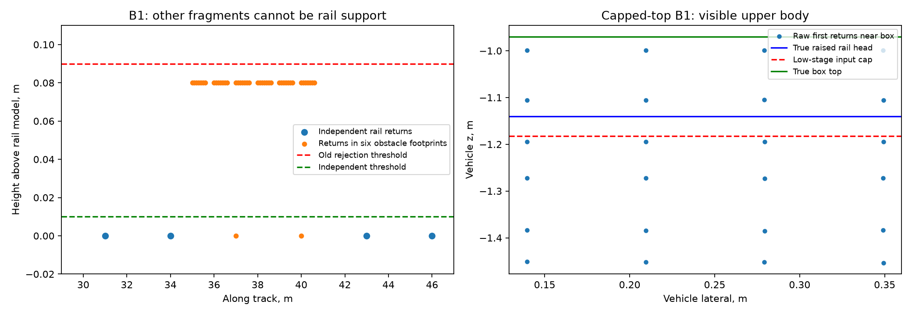

# F1a / B1 author repair — 20 October 2026

**Author repair measured; ride non-regression against starting main fails.** Two
different B1 findings are addressed: the F1 lane's fragmented-object
self-reference, and P4's later capped-top miss. Independent P4 acceptance and
the combined detector reseal are separate pending steps.

## Change

* Default `lowobj.local_rail_exclude_low=true` in the class and both YAMLs.
  Independent rail support excludes every low-cluster footprint, including
  already-weak/advisory clusters and unselected upper points in those
  footprints. A fragmented obstacle cannot use these footprints to support
  the reference used to reject its other pieces.
* F1a requires both the original reference and the independent reference to
  reject the observed top. Missing either reference retains ordinary
  confirmation. The minimum prevents a median raised by point exclusion
  from newly rejecting a cluster the original reference accepted.
* The top includes current-frame points in the low cluster's footprint below
  the existing `foot_max_top`, rather than only the input selected below the
  low-stage floor. Ceiling and neighbouring-footprint controls remain
  rejectable. Cluster geometry/telemetry is not rewritten to manufacture a
  larger reported detection.

The patch is in `resense/lowobj.py`, its detector call site, and the default
configuration. The existing margin, weak-evidence mode and cross-rail-off
setting are retained. The registered design, procedural deviations and a
checked, non-beneficial refinement are in [PROTOCOL.md](PROTOCOL.md).

## Source and method

Starting detector: `cefd4c4`. Main advanced during this work to `a5b0ede`
(backlog and R3 reporting changes). `git diff --quiet` confirms their detector,
native and configuration source is identical. A clean detached reference at
`/tmp/opencode/f1a-b1-reference` supplies fresh paired checks. Candidate
measurements use dirty source, archived byte-for-byte with before/after hashes;
they are not committed-source release acceptance.

No new seal or release is claimed. No held-out G3 data was used.

## Directed checks

* Before repair: **20 failing B1 checks, one passing rejection control**.
  Both rails, common height error, cant, missing support, and already-weak /
  advisory neighbouring fragments are covered.
* After repair: **195 affected tests passed**, one external-path real-data
  test deselected. The later strengthened B1 check passes all **28 B1 tests**:
  all 12 fragments on the two rails confirm as ordinary gauge tracks, not
  merely one surviving track.
* P4 physical first-return scene: 30 stationary runs (three rail elevations,
  four box tops plus empty controls, F1a off/on), plus two 45-frame relative
  approaches. Five stationary positive cases recover **0 →8** matched STOP
  rows each; the other cases lose none. All six empty controls remain empty.
  The relative approach recovers **29 →38** matched rows; its first match
  stays at 54 m. This is synthetic relative motion, not measured train range.
* On 250 captured real pre-rule states, 111 clusters were rejected by the old
  rule; 66 still are, and **no previously accepted cluster is newly weakened**.
  Both rejection and non-rejection branches are exercised. All 250 compact
  point snapshots were checked against the full raw state, with exact rule
  parity; original point indices and full-state hashes are preserved.
* Plain vs read-only traced baseline: all **11,271** continuous ride rows
  match outside timing; 111 rows differ only in latency-driven health level.
* Fresh paired whole Falcon: **4,443 rows**, **1,364 STOP rows** on each side;
  every detection/warning payload is identical, no STOP added or lost.

The plot was inspected against the raw coordinates in
[raw-points.json](raw-points.json): the six 8 cm fragments raise the old line
to 8 cm while independent rail returns are at zero. In the physical box
example the true head is at z −1.14 m, the model at −1.303 m, and raw box
returns around z −1.00 m are visibly above the low-stage cap. These are
specified synthetic stress geometries, not new real-world range guarantees.

## Completed regression checks and the measured cost

| Check | Result |
|---|---|
| Full gate against the registered seal baseline | **PASS**, exit0, no `--allow`, no missing/worse gated row; 15,269 ordinary +3,060 Set F rows |
| Fresh gate against exact starting main | **FAIL**, exactly two gated rows: ride events **18 →23**, ride STOP episodes **24 →26** |
| Real `doubleT_obstacle` and organizer Set O | Every non-timing raw field identical on all **201 +1,510** rows; no labelled detection lost or delayed |
| Five empty recordings | Events /STOP episodes unchanged from main (**7 /11**); `doubleT_platform` has two additional advisory frames |
| Set F | **30 sequences /3,060 rows**, every raw sequence field and every per-kind metric equal to starting main |
| Whole Falcon | **4,443** rows, unchanged detection/warning payloads and STOP row sets |
| Author X3 | **PASS: 40 cases /29,765 rows**; every STOP row set identical to the validated H1 baseline |

X3 uses the original judge workers, transforms, seeds, metrics and tolerances.
[`author_x3.py`](author_x3.py) replaces only the committed-source identity
requirement with checked before/after source hashes. VCS comparison confirms
the H1 baseline detector (`0f02b28`) equals the starting detector bytes. This
is author evidence on dirty source, not the standard committed-source release
acceptance run.

The continuous one-detector ride independently confirms the cost:

| Metric | Starting main | Repair |
|---|---:|---:|
| STOP rows | 109 | 120 |
| STOP events | 20 | 25 |
| STOP episodes | 24 | 26 |
| Low-kind episodes (onset /any row) | 1 /1 | 3 /3 |

All 109 original STOP rows survive. Added STOP rows are **2668–2670,
2674–2677, 4153–4154, 10484–10485**. The original episode at 2671 is extended;
two new episodes start at 4153 and 10484. The 4153 episode reports corridor
kind, not low kind; it is not relabelled by assumed causal association.
There is no added STOP in the failed old cross-rail correction's 5709–5717
region. Full cause attribution of the changed tracker associations is not
claimed. The chunked gate deliberately resets the detector in eight pieces,
so its event/row totals differ from the continuous replay.

**Disposition:** both B1 counterexamples are repaired, with an explicit
false-alarm cost. The stronger no-regression goal against current main is
not met. Independent review and a decision on that cost are needed before
integration/reseal; this record does not close the overall F1 acceptance card.

## Tests and unresolved checks

Full pytest completed: **2,313 passed +17 subtests, three failures**, eight
external-data deselections, no skips. The failures are:

1. `test_timing_with_accumulation`: p95 248 ms in the loaded full run.
   Paired targeted reruns also fail on both unchanged reference and candidate
   (358 /517 ms). This does not establish isolated runtime performance.
   After this session's other long checks finished, the candidate timing-only
   retry still fails at 187 ms p95 (host load average 16.46 on eight CPUs).
2. The inherited proxy-hook negative-source message mismatch: exit86 is
   fail-closed, but the message is `ModuleNotFoundError` rather than the
   expected text. Reproduced on the clean reference and candidate.
3. The node's ring-free callback test produced `FAULT` in the full run;
   targeted reruns pass on both sources. The original failure is retained;
   its exact cause was not instrumented or established.

Independent review, final source acceptance and reseal remain pending. An
independent rail reference here means independence from identified low
footprints, not surveyed rail truth or a guarantee about every unclustered
return.

## Evidence and reproduction

* [Protocol](PROTOCOL.md), [raw-derived audit](audit.json),
  [250-state reference audit](snapshot-audit.json), raw point examples above.
* `raw-evidence.tar.gz` and `raw-manifest.json`: raw gate/ride/Falcon/X3 and
  physical outputs, the validated X3 reference rows, logs, source archives,
  complete compact snapshots, eight full snapshot examples, and test XML.
  `package.json` records check return codes and the archive digest. Every
  archived member is re-read and hashed after packaging.
* `run_check.py` sets the explicit P4 environment and records the exact
  command, source bytes, before/after continuity and exit code. No commit/tag
  is created.
* To re-audit after restoring the archive under `/tmp/opencode`:
  `python docs/evidence/f1a_b1_2026-10-20/audit_results.py --out <audit.json>`.
  `compact_snapshots.py` verifies full/compact rule parity;
  `audit_snapshots.py <snapshot-dir> --out <report.json>` checks reference
  decisions independently of tracker history. The per-frame audit and Set F
  comparer include positive controls that must find an injected difference.

Corrections retained in the work log: the first physical driver used a wrong
`Detection.centroid` attribute (corrected to `center` before completed runs);
the first median-rise unit fixture put a support bin outside the registered
window (34 m, corrected to 35 m). Intermediate candidate checks were stopped
when the capped-top finding was incorporated and are excluded from final
acceptance evidence. They are not reported as passed checks.
