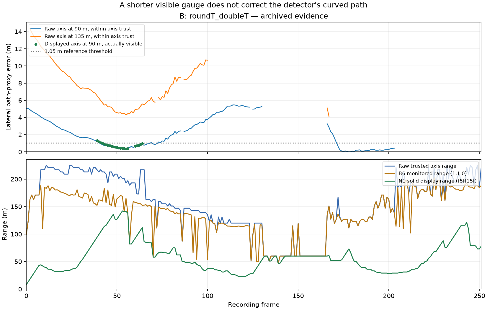
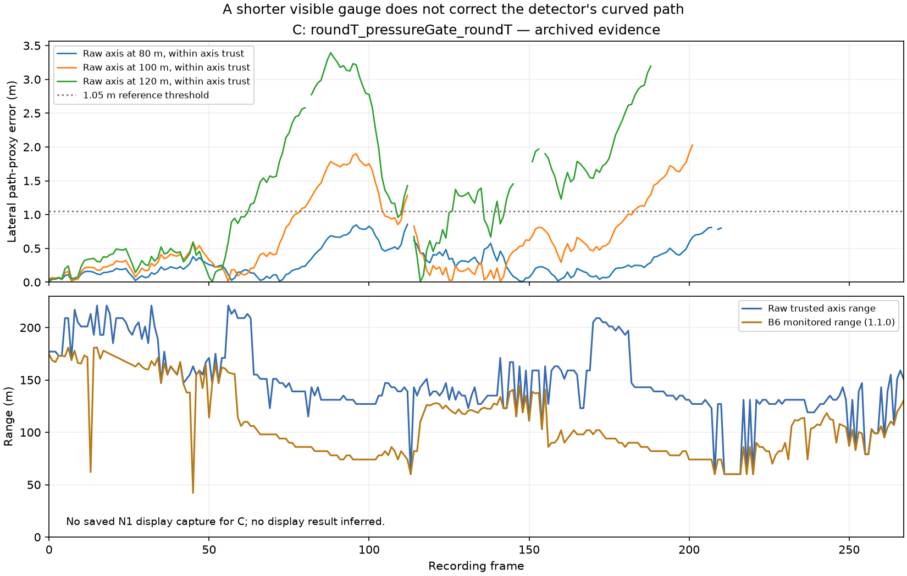

# Archived curve evidence: B6 axis, monitored range and N1 display

**The curve-accuracy problem remains open.** On B's identical visible frame pairs,
the motion-compensated lateral step p90 at 40 m worsens from **0.09017 to
0.09818 m** after display smoothing. The improvements at 80/120 m cover only
**44/11 of 251** possible adjacent pairs. On the same 2,233 visible path-reference
points, absolute error p90 worsens from **0.7987 to 0.8965 m**. Smoother screen
motion and a shorter visible gauge therefore do not establish improved detector
curvature.

This completed offline crosswalk uses 252 B (`roundT_doubleT`) and 268 C
(`roundT_pressureGate_roundT`) archived frames. B has a saved full-precision N1
display capture. **C has no such capture; its display results are unavailable.**
No detector, ICP, ROS or renderer replay was run, and no production file changed.
`complete: true` in [report.json](report.json) describes this scoped analysis,
not K1/K2 acceptance or a new-version measurement. The separate
[P3 handoff](P3_HANDOFF.md) identifies the remaining algorithm work.

## Same-pair stability, with coverage preserved

The following comparison uses the B6 motion-compensated **lateral centerline at
z=0**, transforming the previous frame through its saved full 4×4 ICP pose.
Raw and displayed values use exactly the same pair mask: the distance must be
visible in both frames. Each row's population is separate.

| Distance | Visible pairs / all adjacent pairs | Raw p90, m | Display p90, m |
|---|---:|---:|---:|
| 40 m | 161 / 251 | 0.09017 | 0.09818 |
| 80 m | 44 / 251 | 0.08700 | 0.06146 |
| 120 m | 11 / 251 | 0.14806 | 0.04843 |

N1's original metric is different: **uncompensated adjacent-frame 3D vertex
movement**. Its displayed p90 values are reproduced as 0.03253/0.03055/0.02846 m
at 40/80/120 m, on those same respective masks. These satisfy the original
0.05/0.08/0.15 m display thresholds. They must not be compared directly with
B6's all-frame ICP p90 values, or used to close a curvature-accuracy requirement.
The report retains both metrics, all pair identities and all-frame B6 results.

## Range truncation and error are separate outcomes

The reference is the future driven-sensor path reconstructed from archived ICP,
relative to the **current raw axis center**. It is a trajectory/shape proxy,
not surveyed absolute track-center ground truth. Points are sampled at
10–200 m in 5 m increments, only where the saved forward path exists. Error
fractions below count those frame-distance points, not independent objects or
frames; 1.05 m is a diagnostic threshold, not an obstacle classification.

| Recording and selected range | Median range, m | Reference points | Raw absolute-error median / p90, m | Error >1.05 m |
|---|---:|---:|---:|---:|
| B: raw trusted axis | 157.0 | 5,716 | 0.7691 / 11.3688 | 46.26% |
| B: v1.0.0 monitored | 147.0 | 5,226 | 0.5216 / 7.6903 | 41.22% |
| B: v1.1.0 monitored | 141.9 | 5,108 | 0.4733 / 7.5527 | 40.13% |
| B: N1 solid display; raw axis on identical points | 52.0 | 2,233 | 0.0969 / 0.7987 | 7.30% |
| C: raw trusted axis | 143.0 | 6,337 | 0.1353 / 1.8524 | 16.68% |
| C: v1.0.0 monitored | 130.4 | 5,891 | 0.1125 / 1.3239 | 12.54% |
| C: v1.1.0 monitored | 102.0 | 4,877 | 0.0756 / 0.4247 | 2.17% |

The two archived B6 versions have identical raw track rows on B and C. The
monitored-range improvement is the existing honest-range restriction, not a new
axis fit. For B's **same 2,233 displayed points**, the displayed axis has median
error **0.1575 m**, p90 **0.8965 m**, and **7.84%** above 1.05 m, compared with
the raw axis's 0.0969 m / 0.7987 m / 7.30%. The much smaller fraction than the
full monitored-range result primarily reflects excluding distant points.
Aligning each display to its own center instead changes p90 to 0.8886 m; the
conclusion is unchanged. The principal calculation keeps the common raw-center
anchor so that display-center lag is not silently removed.

B's raw axis still has median errors **1.78 m at 90 m** (169 supported frames)
and **7.42 m at 135 m** (102 frames), within its declared axis range. In the
previously documented C curve window, frames 57–117, the path-proxy median
errors are 0.46/0.98/1.92 m at 80/100/120 m across all 61 frames. That window
comparison is not conditioned on the shorter monitored range and is not the
wall-reference acceptance metric in K2.





Plot gaps mean missing forward-path support or a distance outside axis trust,
not zero error. C deliberately has no inferred display curve.

## Correspondence and provenance

| Input | Immutable evidence/source identity | Verification |
|---|---|---|
| P4 B6 poses, tracks, monitored ranges and published measures | `1b880168ce2dbeec2071838892ac05eed5a9166a` | Original `b6_raw.tar.xz` SHA-256 `e0bd5ba9c44f7c9dc3413deb0f0b02ac289f7c9f77f0e2551cfc2ddb77827ab9`; matches its committed checksum |
| N1 B full-precision rows and execution report | Evidence `cf188486f5c2339cd74adcb52ecdd21a59f8fad0`; measured runtime `f5ff15f` | Row SHA-256 `e9b3ea4d52d7bfdb0c1688a350939c67fdef8aa3a4e1b7d83ce8a548be42cdd1`; original report has identical start/end source hashes |
| N1 B cache metadata | Original `/home/resense/data/decoded/roundT_doubleT/meta.json` | SHA-256 `51004f10044870d65574a3b9b1f0025f082c6ece10f93e9b1feccb9e95f6e621`, matching the execution report; all 252 frame indices/timestamps match |

Every B raw-axis sample at 40/80/120 m agrees **exactly** between B6 and the
full-precision N1 rows: 756/756, maximum difference zero. All axis-valid and
monitored ranges also agree. B6's saved model rotation is identity; N1 reports
configured zero mounting angles on every frame. B6 does not retain source
timestamps or point-payload hashes, so this is a strong frame/geometry
correspondence, **not proof of byte-identical input clouds**.

The source-hash-verified display implementation applies one scalar EMA/reset
to the whole lateral profile. Since the raw profile is quadratic, the saved
full-precision samples at 40/80/120 m determine the displayed quadratic at the
integer grid nodes used here. The analyzer checks the EMA recurrence on all
252 frames; maximum sample residual is `4.44e-16 m`. It does not reconstruct
geometry from rounded `Result.to_dict()` values. The source identities remain
those of the historical captures; these rows are not relabeled as a later
selected detector or the 1.2.0 candidate.

The saved full 4×4 transforms are composed with segment breaks respected.
No path is extrapolated beyond its saved forward extent or across a break.
The independent arithmetic reproduces both B6 versions' published honesty
counts/fractions, fixed-distance error quantiles and all-frame lateral jitter
at their published precision, and N1's original pair counts/3D p90 values.
This validates the crosswalk arithmetic; it does not upgrade ICP to surveyed
truth or create missing C display evidence.

## Reproduce and inspect

From the repository root, with the pinned Git objects and B cache metadata
available:

```sh
python docs/evidence/p4_followup_2026-10-18/curve_analysis/analyze.py
python docs/evidence/p4_followup_2026-10-18/curve_analysis/plot.py
```

[analyze.py](analyze.py) binds all consumed Git blobs, archive members, metadata
and its own source in [report.json](report.json). Only selected B/C records are
duplicated in [inputs/b6_B_C_subset.json.gz](inputs/b6_B_C_subset.json.gz), with
the verified [B metadata](inputs/B_cache_meta.json.gz). The deterministic
[row archive](crosswalk_rows.json.gz) preserves per-frame ranges, per-point
errors and inclusion masks. [figure_receipt.json](figure_receipt.json) binds
the plotting source, report, row archive and figures. No large source cloud or
complete remote evidence tree is copied.
