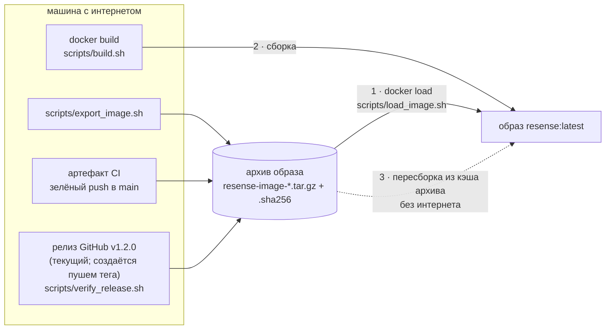

# Где взять образ Docker

Есть три способа — в зависимости от того, есть ли на машине интернет.



## 1. Загрузить готовый архив (интернет не нужен)

На стенде организаторов нет интернета, поэтому образ поставляется одним gzip-архивом, рядом с
которым лежит его контрольная сумма:

```bash
sha256sum -c resense-image-<version>.tar.gz.sha256   # необязательно: проверка
docker load -i resense-image-<version>.tar.gz        # теги resense:<version> и resense:latest
```

`scripts/load_image.sh <archive>` за один шаг проверяет контрольную сумму, загружает образ и
выполняет его первый запуск с `--network none`.

**Откуда взять архив:**

* **Артефакт CI** — его создаёт каждый зелёный пуш в `main`. На GitHub: *Actions* → прогон `ci`
  нужного коммита (задание `offline-build` зелёное) → *Artifacts* →
  `resense-image-<version>-<commit>` (zip с `.tar.gz` и его `.sha256`; хранится 30 дней; для
  скачивания нужен вход в GitHub). Артефакты хранятся 30 дней и могут отсутствовать: берите
  архив релиза [v1.2.0](https://github.com/pmixay/ReSense/releases/tag/v1.2.0) (опубликован 20.10; sha256 `89bd6b54c139e57c86ed222845f80816d7364b9e39f3cb80878576c7d5eba67c`, `scripts/verify_release.sh v1.2.0`) или экспортируйте образ сами.
* **Экспортировать самостоятельно** на любой машине с интернетом и Docker:

  ```bash
  scripts/export_image.sh          # собирает из HEAD с --no-cache → dist/resense-image-<version>.tar.gz + .sha256
  ```

  `SKIP_BUILD=1 SOURCE_IMAGE=resense:latest scripts/export_image.sh` вместо сборки сохраняет уже
  имеющийся образ. Образ из текущего исходного дерева содержит кандидата 1.3.0 (не выпущен, без тега и архива): его возможности есть только в таком собственном образе.

* **[Релиз GitHub `v1.2.0`](https://github.com/pmixay/ReSense/releases/tag/v1.2.0)** — текущий
  опубликованный (20.10, тег `3b73bbe`): архив `resense-image-v1.2.0.tar.gz` 472 124 881 байт, его `.sha256` в *Assets*.
  Сборку и публикацию выполняет
  заданием [`release.yml`](https://github.com/pmixay/ReSense/blob/main/.github/workflows/release.yml),
  при пуше тега; `scripts/verify_release.sh v1.2.0` скачивает архив в `dist/` и проверяет его.
  Прежний [релиз `v1.0.0`](https://github.com/pmixay/ReSense/releases/tag/v1.0.0) (29.09, тег `5d6e9b5`, архив 477 449 541 байт)
  остаётся доступным: `scripts/verify_release.sh v1.0.0`. Судья проверил sha256 и офлайн-запуск архива v1.0.0 13.10; D1 15.10 проверил наличие его ассетов по API.

## 2. Собрать (нужен интернет)

```bash
docker build -t resense -f docker/Dockerfile .    # или ./scripts/build.sh
```

Сборка скачивает `ros:humble-ros-base-jammy`, ставит пакеты ROS через apt и Python-пакеты точно
зафиксированных версий через pip, а также компилирует необязательные ядра на C++.
В CI, проверенном судьёй 13.10, сборка заняла 1:43; исторический `--no-cache` на ВМ — около 9 мин.
Время зависит от кэша и сети; на стенде без сети нужен готовый архив. Полезные варианты:

```bash
PULL=1 ./scripts/build.sh          # сначала обновить базовый ros:humble (старый из кэша ломает apt-get update)
WITH_TOOLS=1 ./scripts/build.sh    # + rosbags / matplotlib / open3d / pytest: образ, на котором тестирует CI
```

## 3. Пересобрать без интернета из загруженного архива (без гарантий)

После шага 1, в рабочей копии того же коммита, все слои могут взяться из кэша архива:

```bash
chmod -R u+rwX,go+rX,go-w . && docker build --cache-from resense:<version> -t resense -f docker/Dockerfile .
```

Если не получилось, образ из шага 1 остаётся нетронутым и рабочим. Подробнее: [Стенд без
интернета](../guides/offline-stand.md).

## Что внутри

В рабочем образе только то, что нужно ноде: ROS 2 Humble (`ros-base`), rosbag2 с плагинами sqlite3
и MCAP, RViz, `foxglove_bridge`, пакет `resense` с зафиксированными версиями numpy / scipy /
scikit-learn / pyyaml, скомпилированные ядра на C++ и ROS-пакет `resense_ros`. Читалки бэгов без
ROS (`rosbags`), Open3D и набора тестов в нём **нет**; они добавляются с `WITH_TOOLS=1`.

Команда по умолчанию: `ros2 launch resense_ros detector.launch.py freshness_mode:=replay` — нода с
автопоиском топиков, настроенная для записанных бэгов. На поезде с живым LiDAR вместо этого
передайте `freshness_mode:=live` (собственное значение ноды по умолчанию).
