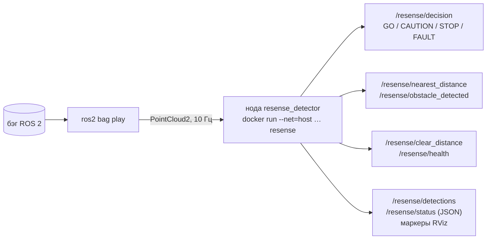

# Запуск на бэге

В режиме ROS ReSense сам никогда не открывает файлы бэгов: нода подписывается на облака точек,
которые публикует `ros2 bag play`, — точно так же, как подписалась бы на драйвер живого LiDAR.



## Одной командой

Нужны только Docker и образ (уже загруженный или переданный архивом):

```bash
scripts/play_bag.sh <bag directory>
scripts/play_bag.sh <bag directory> --archive resense-image-<version>.tar.gz
```

Скрипт по возможности поднимает буфер UDP, загружает архив, запускает ноду и слушателя (ждёт готовности каждого не дольше
`READY_TIMEOUT` с, по умолчанию 60), проигрывает бэг из того же образа и печатает каждую смену решения:

```text
== doubleT_obstacle: playing as uid:gid 1000:1000; decision changes (time since start, decision, nearest distance):
    0.0 s  FAULT   -
    5.2 s  CAUTION -
    5.9 s  STOP    55.6 m
== doubleT_obstacle played; node stopped
```

(Время в примере условное.) `FAULT` — до первого кадра; `CAUTION` (иногда вперемешку с коротким
`FAULT`) — пока нода догоняет стартовую пачку плеера (ниже); на этой записи `STOP` идёт без
пропусков до конца, поэтому других смен нет (одиночный `GO` на кадре 111 исправлен 29.09, см.
[Результаты и ограничения](../reference/results.md)). Код выхода 2 — неверный аргумент, 3 — нет
Docker, нет образа или нода не запустилась.

## Интерактивный запуск и Falcon (1.2.0)

Нужен образ 1.2.0 (релиз `v1.2.0` или сборка из исходного кода); архив v1.0.0 новых профилей не содержит.

```bash
docker build -t resense:lidar-work -f docker/Dockerfile .
IMAGE=resense:lidar-work scripts/play_bag.sh --interactive --rate 0.5 \
  --clear-range-policy conservative \
  --sensor-profile pandar128 /data/PANDAR_BAG \
  --sensor-profile falcon_ros /data/falcon_test_second_dark
```

Space — пауза/продолжение, Right — следующее сообщение на паузе, Up/Down — изменение скорости.
Профиль относится к следующим за ним бэгам. Все бэги проходят через одну ноду; между ними
скрипт дожидается тишины, выбирает профиль и вызывает `/resense/reset_input`. Это очищает
очереди, треки, калибровку, прежний STOP и временную эпоху даже при одинаковых топике, frame id
и метках времени. При поступлении данных или недообработанной очереди сброс запрещён;
перед границей остановите плеер. Следующая запись должна подтвердить собственную свежесть. Для пакетного запуска уберите `--interactive`.

Имя контейнера ноды печатается при старте; в другой консоли:

```bash
docker exec -it <напечатанное-имя-контейнера> bash
```

Поставленный Falcon публикует `/iv_points`, frame id `seyond`, в ROS-осях +X/+Y/+Z
(`falcon_ros`). Для нативных осей производителя выбирайте `falcon_native` (+Z/−Y/+X).
`pandar128` задаёт −Y/+X/+Z; `manual` сохраняет явную конфигурацию. Профиль не угадывается
по топику. Не смешивайте именованный профиль с ручными осями/углами крепления.

Прямой запуск ноды для поставленного Falcon:

```bash
docker run --rm -it --net=host --ipc=host resense:lidar-work \
  ros2 launch resense_ros detector.launch.py freshness_mode:=replay \
  sensor_profile:=falcon_ros input_topic:=/iv_points clear_range_policy:=conservative
```

Консервативный C2 не переносит модель плотности Pandar на Falcon: `monitored_small=null`,
`clear_distance=0`, при этом детектор продолжает выдавать обнаружения и STOP.

Для графики используйте ту же очередь с `scripts/run_demo.sh`. При отсутствии GPU:

```bash
IMAGE=resense:lidar-work LIBGL_ALWAYS_SOFTWARE=1 scripts/run_demo.sh \
  --rate 0.5 --sensor-profile falcon_ros /data/falcon_test_second_dark
# Без физического экрана, для проверки X11/RViz:
IMAGE=resense:lidar-work xvfb-run -a scripts/run_demo.sh --software-rendering \
  --rate 0.5 --sensor-profile falcon_ros /data/falcon_test_second_dark
```

Бокс габарита ограничен поддержанной дальностью оси и контроля; отображение сглаживается, но при расхождении с текущей геометрией
больше 0,25 м сокращается, а решения детектора не меняет. При невалидном входе серый контур исчезает после трёх пропущенных
обновлений либо при возрасте ≥ 0,5 с; маркер в RViz живёт не более 0,5 с от получения, даже заблокированная нода не оставляет
постоянный зелёный контур (при обновлении реже 2 Гц контур может исчезать между кадрами). Значения — в `status.gauge`;
[контракт и доказательства](../../docs/evidence/n1_n4_2026-10-18/HOWTO.md).

## Пошагово (консоль организаторов)

Три консоли на одной машине.

**0. Один раз после загрузки системы** — буфер приёма UDP для облаков 360° (нужен с плеером на
CycloneDDS, в остальных случаях не мешает):

```bash
sudo sysctl -w net.core.rmem_max=33554432
```

**1. Нода** (консоль 1):

```bash
docker run --rm -it --net=host --ipc=host resense
```

* `--net=host` обязателен: образ передаёт DDS только по UDP; в bridge-сети Docker плеер и нода не
  находят друг друга.
* Команда образа по умолчанию передаёт `freshness_mode:=replay`, который нужен для записанных
  бэгов. Сохраните его, если задаёте свою команду (`… detector.launch.py freshness_mode:=replay …`):
  собственный режим ноды по умолчанию, `live`, сравнивает метки времени кадров с системными часами
  и на записи отвечает `FAULT`.
* Нода готова, когда в её логе появилась строка `ReSense detector listening on …` (перед ней —
  `warm-up: … ms`). Запускайте плеер после неё.

**2. Плеер** (консоль 2, любой пользователь, ROS 2 Humble на хосте):

```bash
ros2 bag play <bag> --delay 3 --read-ahead-queue-size 10
```

Без ROS 2 на хосте используйте плеер из образа:

```bash
docker run --rm --net=host -v <folder with bags>:/data:ro resense \
  ros2 bag play /data/<bag> --delay 3 --read-ahead-queue-size 10
```

* `--delay 3` даёт DDS завершить обнаружение участников до первого облака.
* `--read-ahead-queue-size 10` — поддерживаемый режим проигрывания. Со значением Humble по умолчанию
  (1 000 сообщений) плеер предзагружает короткую запись, пока уже идут его часы, а затем отправляет
  всю запоздавшую запись пачкой: на 360° бэге нода успевает обработать лишь часть кадров, и все
  результаты помечаются устаревшими.
* `ROS_DOMAIN_ID` у плеера и ноды должен совпадать (по умолчанию 0).

**3. Ответ** (консоль 3):

```bash
ros2 topic echo /resense/decision --field data          # GO | CAUTION | STOP | FAULT
ros2 topic echo /resense/nearest_distance --field data  # м вдоль пути, −1 — нет
```

Что означают значения: [Как читать результат](read-the-output.md).

## Старт и остановка ноды <a href="#startup" id="startup"></a>

1. **Прогрев** (`warmup`, по умолчанию включён). До строки «listening» нода прогоняет
   декодирование и отдельный детектор на трёх синтетических кадрах — около 0,7 с. Поэтому первый
   настоящий кадр обрабатывается так же быстро, как следующие. Собственный детектор ноды начинает
   с первого настоящего кадра: калибровка крепления и модель пути берутся из бэга.
2. **Стартовая пачка.** Даже с `--read-ahead-queue-size 10` плеер отправляет первые доли секунды
   записи почти без пауз. Нода по умолчанию обрабатывает каждый кадр стартовой
   пачки (`catchup_startup_step` = 0; допустимое отставание — до `catchup_startup_max_lag`, 20 с).
   Явное `catchup_startup_step:=0.2` включает прореживание до 5 Гц с намеренными пропусками
   (`node.catchup_skipped`; было умолчанием до PR #27, 29.09). Кадр, который ждёт один, обрабатывается сразу. Пока нода догоняет,
   решение — `CAUTION` (`freshness.reason`: `catchup`), если только это не `STOP`.
3. **Позже в записи** (задержка передачи, медленный диск) отставание разбирается с шагом
   `catchup_step` = 0,3 с; кадры старше самого нового больше чем на `catchup_max_lag` (5 с)
   отбрасываются.
4. **Остановка.** Ctrl+C в консоли ноды завершает её чисто: launch не сообщает об ошибке.

Сколько это даёт по времени (первые результаты, первый `STOP`), измерено на странице
[Результаты и ограничения](../reference/results.md#speed).

## Несколько бэгов в одну ноду

Нода слушает обе известные пары топика и системы координат (`/lidar_points` в `hesai_lidar`,
`/sensing/lidar/hesai128/pointcloud` в `lidar_livox`) и, если не задано `auto_discover:=false`,
любой другой топик `PointCloud2`. Для новой записи (другой топик или frame id либо метки времени,
скачущие больше чем на `new_input_gap`, 30 с вперёд или 0,5 с назад) создаётся свежий детектор, поэтому бэги можно
проигрывать один за другим в одну запущенную ноду без её перезапуска.

## Через docker compose

Папка с бэгами — `$RESENSE_DATA` (по умолчанию `/data/for_hackathon`), бэг внутри неё —
`$RESENSE_BAG`:

```bash
docker compose up detector                        # нода без GUI
docker compose --profile tools up player          # проигрывает в неё $RESENSE_BAG
docker compose --profile tools run --rm echo      # печатает /resense/decision
RESENSE_DATA=/mnt/bags RESENSE_BAG=doubleT_obstacle docker compose --profile tools up
```

Если `resense:latest` уже загружен, compose ничего не собирает и не скачивает; на машине без
интернета не передавайте `--build`.

Без Docker и ROS бэг обрабатывает тем же детектором [веб-прототип](../visualisation/web-prototype.md) (онлайн —
[resense.arbuz.lol](https://resense.arbuz.lol/), свой экземпляр — `scripts/run_webapp.sh` → http://localhost:8080; вне релиза `v1.0.0`
и образа Docker). Обёртки `scripts/run_demo.sh` (нода + RViz, X11) и `scripts/run_headless.sh` (без X11, печатает `OBSTACLE 55.7 m`)
запускаются так же: `./scripts/run_demo.sh /data/for_hackathon/roundT_doubleT`.
